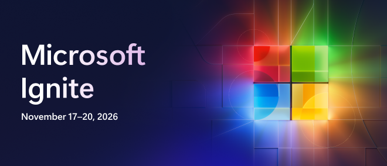

<a name="start-building"></a>

<p align="center">

</p>

# [Microsoft Ignite 2026](https://ignite.microsoft.com)

## 🔥LAB652: Delegate complex work: Hands-on with Copilot Cowork
### Session description

Agent usage is up 15× year over year, and more multi-step workflows can now be delegated end to end. In this hands-on session, build a real workflow with Copilot Cowork: turn a complex process into a skill, extend it with plugins and automations, and see how Cowork plans, executes, and delivers work across systems and apps. Leave with a publishable skill and a practical model for deciding what to delegate, how to scope it, and how to move work from intent to done.

### 🚀 Getting started

#### In a guided session

If you're following along during a live session:

1. Sign in to the lab computer with the details at the top of the lab instructions.
2. Follow the steps in the lab instructions. They are the same as [`instructions/lab-manual.md`](instructions/lab-manual.md).
3. Ask the proctors for help if Cowork shows **Request access**.

#### On your own

If you're learning at your own pace:

1. You need a Microsoft 365 work account with a Microsoft 365 Copilot license and access to [Copilot Cowork](https://learn.microsoft.com/copilot/cowork/).
2. Upload the 2 files in [`data/`](data/) (`Project-Tracker.xlsx` and `Meeting-Notes.docx`) to your OneDrive.
3. Follow the steps in [`instructions/lab-manual.md`](instructions/lab-manual.md). The finished skill is in [`skills/weekly-status-report/`](skills/weekly-status-report/SKILL.md) and the plugin is in [`src/LAB652-plugin.zip`](src/LAB652-plugin.zip).

### 🎯 Learning outcomes

By the end of this session, you will be able to:

- Give a job with many steps to Copilot Cowork and check the result before anything is sent.
- Turn the job into a reusable skill and improve it with the Skill Report.
- Extend Cowork with a plugin that adds a skill and a connector (Microsoft Learn MCP Server).
- Run the job on a schedule with an automation, and share the skill with a colleague.

### 💻 Technologies used

- [Microsoft 365 Copilot](https://learn.microsoft.com/copilot/microsoft-365/microsoft-365-copilot-overview)
- [Copilot Cowork](https://learn.microsoft.com/copilot/cowork/)
- [Microsoft Learn MCP Server](https://learn.microsoft.com/training/support/mcp)
- [Microsoft OneDrive](https://learn.microsoft.com/onedrive/)
- [Microsoft Outlook](https://learn.microsoft.com/outlook/)

### 📚 Continue your learning

Pick your next step based on your learning style:

| Resource | What you'll get |
|----------|-----------------|
| **[Ignite 2026 Next Steps](https://aka.ms/ignite26-next-steps)** | Additional session repos and materials from Microsoft Ignite 2026 |
| **[Microsoft AI Skills Navigator](https://aka.ms/ignite26-asn)** | Discover AI skills, learning paths, and resources for your next step |
| **[Microsoft Learn](https://aka.ms/ignite26-learn)** | Official documentation and guided learning paths on these topics |
| **[Microsoft Foundry Community](https://aka.ms/MicrosoftFoundryDiscord-Ignite26)** | Connect with other learners and experts in our Discord community |

### 🌟 Microsoft Learn MCP Server

<!-- Remove this section if the Microsoft Learn MCP Server is not relevant to the session. -->

The Microsoft Learn MCP Server gives your AI agent direct access to Microsoft's official documentation — grounded, up-to-date answers about the topics in this session.

**GitHub Copilot CLI** — Install with:

```shell
copilot plugin install microsoftdocs/mcp
```

**VS Code** — One-click install:  
[](https://vscode.dev/redirect/mcp/install?name=microsoft-learn&config=%7B%22type%22%3A%22http%22%2C%22url%22%3A%22https%3A%2F%2Flearn.microsoft.com%2Fapi%2Fmcp%22%7D)

For more information, visit the [Learn MCP Server repo](https://aka.ms/learnmcp).

### 👥 Content owners

<table>
<tr>
    <td align="center"><a href="https://github.com/babrekel">
        <br />
        <sub><b>Bas Brekelmans</b></sub></a><br />
            <a href="https://github.com/babrekel" title="talk">📢</a>
    </td>
</tr></table>

### ⚖️ Trademarks

This project may contain trademarks or logos for projects, products, or services. Authorized use of Microsoft trademarks or logos is subject to and must follow [Microsoft's Trademark & Brand Guidelines](https://www.microsoft.com/legal/intellectualproperty/trademarks/usage/general). Use of Microsoft trademarks or logos in modified versions of this project must not cause confusion or imply Microsoft sponsorship.

Any use of third-party trademarks or logos are subject to those third-party's policies.
